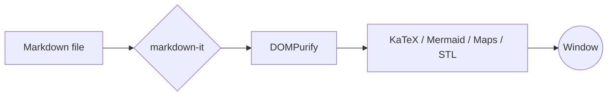
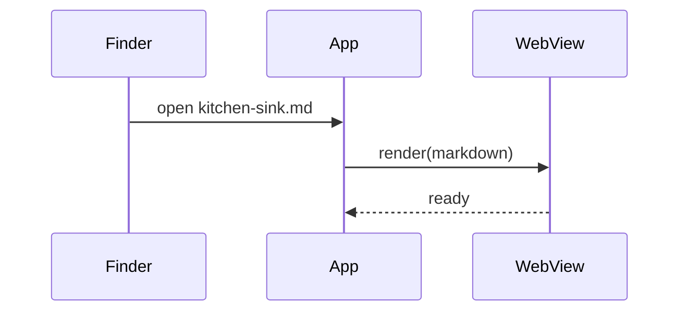

# Markfetti — kitchen sink

 Every GitHub Markdown feature in one file. Edit and save this file while it's open to see live reload.

Use **View ▸ Show Outline** to see a list of headings.

## Text

*Italic*, **bold**, ***both***, ~~strikethrough~~, `inline code`, <kbd>⌘</kbd>+<kbd>C</kbd>, H<sub>2</sub>O, x<sup>2</sup>, and <ins>underlined</ins>.
Autolinks: https://github.com and www.example.com. Emoji: :tada: :rocket: :+1: 🙂

A line ending in two spaces  
breaks, and a backslash\
does too.

> A plain blockquote.
>> Nested.

## Alerts

> [!NOTE]
> Useful information that users should know, even when skimming content.

> [!TIP]
> Helpful advice for doing things better or more easily.

> [!IMPORTANT]
> Key information users need to know to achieve their goal.

> [!WARNING]
> Urgent info that needs immediate user attention to avoid problems.

> [!CAUTION]
> Advises about risks or negative outcomes of certain actions.

## Lists

1. First
2. Second
   - Nested bullet
     1. Deeper
3. Third

- [x] Finished task
- [ ] Open task
  - [ ] Nested task

## Tables

| Left | Center | Right |
|:-----|:------:|------:|
| `a`  | **b**  | 1.00  |
| long cell with a [link](other.md) | :smile: | 22.50 |

## Code

```swift
struct Greeter {
    let name: String
    func greet() -> String { "Hello, \(name)!" }
}
```

```python
def fib(n: int) -> int:
    return n if n < 2 else fib(n - 1) + fib(n - 2)
```

```diff
- old line
+ new line
```

```console
$ echo "not math"
not math
```

## Math

Inline math: $e^{i\pi} + 1 = 0$, and the backtick form $`\sqrt{x^2+y^2}`$. Money stays money: it costs $5 and $10, or \$20.

Display math:

$$
\int_{-\infty}^{\infty} e^{-x^2}\,dx = \sqrt{\pi}
$$

$$\left( \sum_{k=1}^n a_k b_k \right)^2 \leq \left( \sum_{k=1}^n a_k^2 \right) \left( \sum_{k=1}^n b_k^2 \right)$$

```math
\begin{bmatrix} a & b \\ c & d \end{bmatrix}
\begin{bmatrix} x \\ y \end{bmatrix}
=
\begin{bmatrix} ax + by \\ cx + dy \end{bmatrix}
```

Underscores inside math don't turn into italics: $a_1 + b_2 = c_{12}$.

## Mermaid





## GeoJSON

```geojson
{
  "type": "FeatureCollection",
  "features": [
    { "type": "Feature", "properties": { "name": "Golden Gate Park" },
      "geometry": { "type": "Polygon", "coordinates": [[[-122.511,37.771],[-122.454,37.773],[-122.453,37.766],[-122.510,37.764],[-122.511,37.771]]] } },
    { "type": "Feature", "properties": { "name": "Ferry Building" },
      "geometry": { "type": "Point", "coordinates": [-122.3937, 37.7955] } }
  ]
}
```

## TopoJSON

```topojson
{
  "type": "Topology",
  "objects": { "example": { "type": "GeometryCollection", "geometries": [
    { "type": "Point", "properties": { "prop0": "value0" }, "coordinates": [102, 0.5] },
    { "type": "LineString", "properties": { "prop0": "value0" }, "arcs": [0] },
    { "type": "Polygon", "properties": { "prop0": "value0" }, "arcs": [[-2]] }
  ] } },
  "arcs": [
    [[102, 0], [103, 1], [104, 0], [105, 1]],
    [[100, 0], [101, 0], [101, 1], [100, 1], [100, 0]]
  ]
}
```

## STL

```stl
solid pyramid
  facet normal 0 0 -1
    outer loop
      vertex 0 0 0
      vertex 1 0 0
      vertex 1 1 0
    endloop
  endfacet
  facet normal 0 0 -1
    outer loop
      vertex 0 0 0
      vertex 1 1 0
      vertex 0 1 0
    endloop
  endfacet
  facet normal 0 -1 1
    outer loop
      vertex 0 0 0
      vertex 0.5 0.5 1
      vertex 1 0 0
    endloop
  endfacet
  facet normal 1 0 1
    outer loop
      vertex 1 0 0
      vertex 0.5 0.5 1
      vertex 1 1 0
    endloop
  endfacet
  facet normal 0 1 1
    outer loop
      vertex 1 1 0
      vertex 0.5 0.5 1
      vertex 0 1 0
    endloop
  endfacet
  facet normal -1 0 1
    outer loop
      vertex 0 1 0
      vertex 0.5 0.5 1
      vertex 0 0 0
    endloop
  endfacet
endsolid pyramid
```

## HTML

<details>
<summary>Click to expand</summary>

Hidden content with **Markdown** inside.

</details>

<p align="center">Centered with <code>align="center"</code></p>

<picture>
  <source media="(prefers-color-scheme: dark)" srcset="https://img.shields.io/badge/theme-dark-blue">
  
</picture>

<script>alert('scripts are stripped, like on GitHub')</script>

## Footnotes

Here's a sentence with a footnote.[^1] And another.[^note]

[^1]: The first footnote.
[^note]: A named footnote, with `code`.

---

Links: [jump to Tables](#tables) · [another file](other.md) · [a section in it](other.md#a-section)
